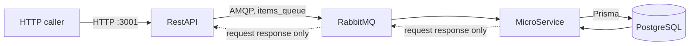
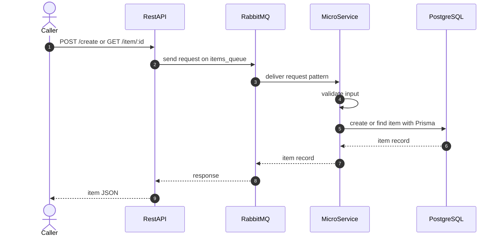
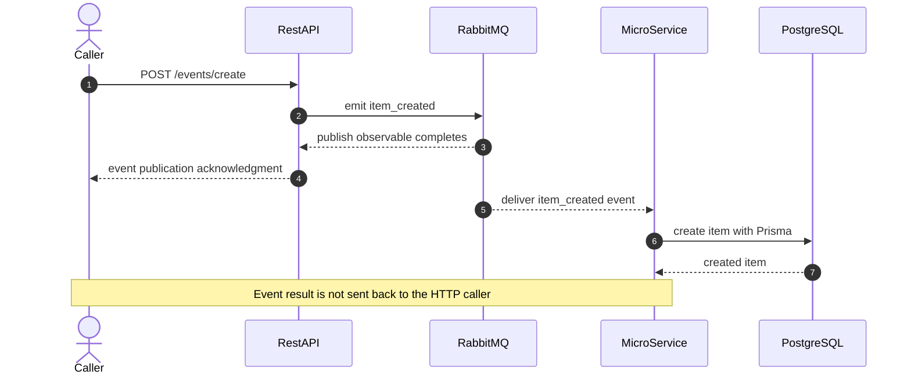

# NestJS Event-Driven Microservices

A learning project with two NestJS applications: `RestAPI`, an HTTP gateway, and `MicroService`, an RMQ worker. The microservice validates item requests and persists records in PostgreSQL with Prisma. RabbitMQ carries both request-response messages and one-way events.

## Project Structure

- `RestAPI/`: HTTP API on port `3001`; sends request-response messages to RabbitMQ.
- `MicroService/`: RabbitMQ handlers and Prisma-backed item operations.
- `MicroService/docker/docker-compose.yml`: the complete local stack, including both apps, RabbitMQ, PostgreSQL, and the Prisma migration job.

## Architecture



`RestAPI` is the HTTP entry point. It connects to RabbitMQ using the queue name `items_queue`; inside Compose, containers reach each other by service name. The microservice is not exposed as a public HTTP API.

## Request-Response Workflow

Use this flow when the HTTP caller needs a result. The request patterns are `{ role: 'item', cmd: 'create' }` and `{ role: 'item', cmd: 'get-by-id' }`.



Expected validation and not-found failures are returned as HTTP errors. If the microservice cannot be reached, `RestAPI` returns a service-unavailable error.

## Event Workflow

Use events for one-way notifications when the publisher does not need the database result. The supported patterns are `item_created` and `get-item-by-id`.



`GET /events/item/:id` similarly emits `get-item-by-id`. The microservice performs the lookup, but the result is not returned through the event channel. For a lookup result, use `GET /item/:id` instead.

## Requirements

- Docker Desktop or Docker Engine with the Compose plugin

## Run with Docker Compose

From the repository root, build and start the complete stack:

```powershell
docker compose -f .\MicroService\docker\docker-compose.yml up --build
```

Compose waits for PostgreSQL and RabbitMQ to become healthy, runs the Prisma migration, then starts `MicroService` and `RestAPI`. The API is available at `http://localhost:3001`.

| Service | Host port | Purpose |
| --- | ---: | --- |
| RestAPI | `3001` | HTTP endpoints |
| RabbitMQ | `5672` | AMQP messaging |
| RabbitMQ management | `15672` | Broker management UI |
| PostgreSQL | `5432` | Item database |

The database uses a named volume, so its data remains when containers stop. Stop the stack with:

```powershell
docker compose -f .\MicroService\docker\docker-compose.yml down
```

Compose defaults are for local development. Set `POSTGRES_USER`, `POSTGRES_PASSWORD`, `POSTGRES_DB`, and `ITEMS_QUEUE` in the environment to override them.

## HTTP API

### `POST /create`

Create an item. The item must have a non-empty `name` string.

```http
POST http://localhost:3001/create
Content-Type: application/json
```

```json
{
  "name": "Example item"
}
```

Returns the created item after the microservice stores it, for example:

```json
{
  "id": 1,
  "name": "Example item"
}
```

### `GET /item/:id`

Fetch an item by its positive integer ID.

```http
GET http://localhost:3001/item/1
```

Returns the matching item record, for example:

```json
{
  "id": 1,
  "name": "Example item"
}
```

### Event examples

- `POST /events/create` publishes an `item_created` event and returns an acknowledgment.
- `GET /events/item/:id` publishes a `get-item-by-id` event and returns an acknowledgment. The microservice performs the lookup, but the result is not returned to the HTTP caller.

### `GET /`

Returns `Hello World!` from the RestAPI application.

## Technology

NestJS, TypeScript, RabbitMQ, PostgreSQL, Prisma, and Docker Compose.
